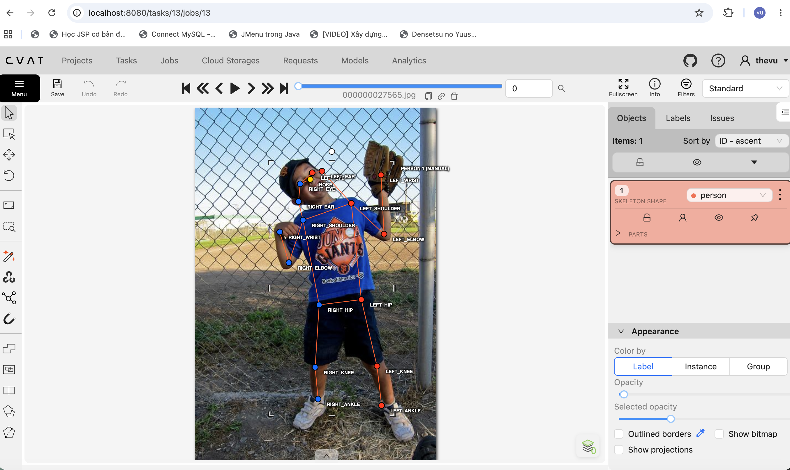
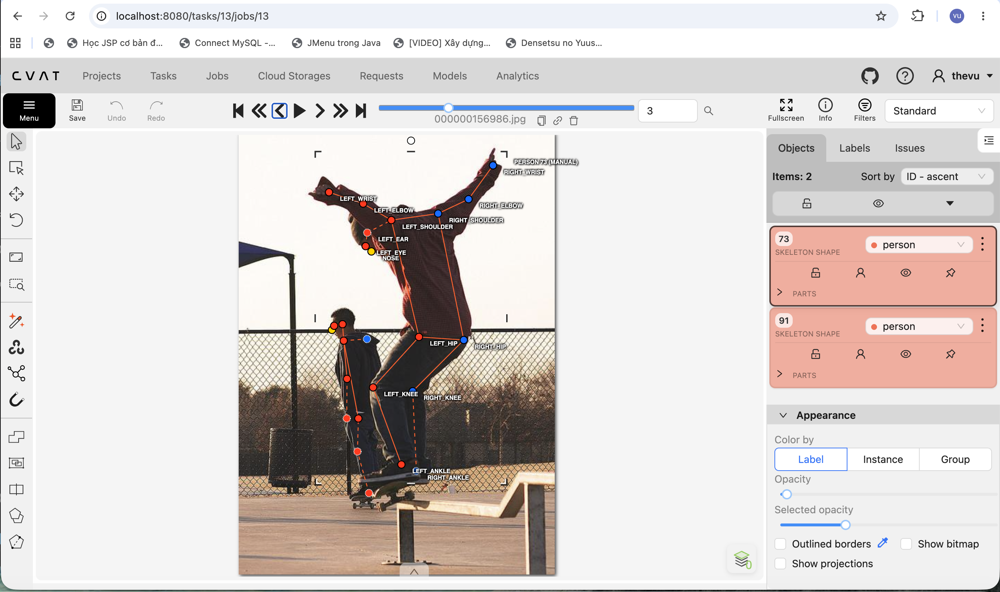
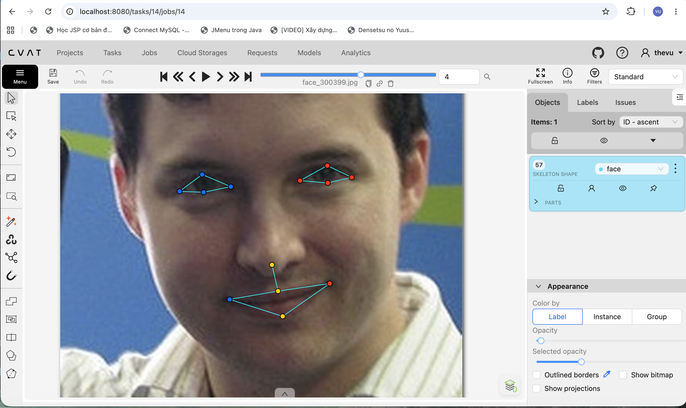
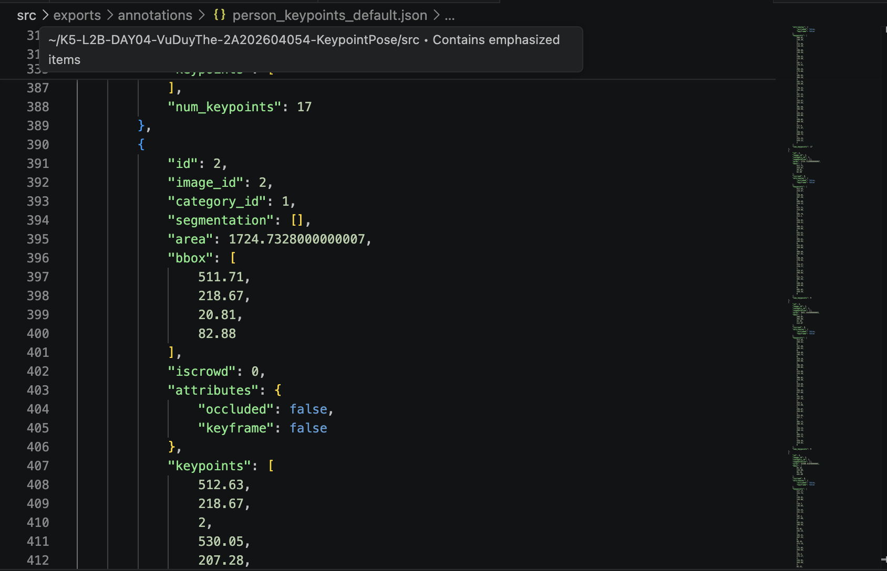

# Báo cáo cá nhân — HoVaTen-MSSV

Đổi tên file theo quy tắc `MSSV_HoTen.md`. Ví dụ: `20241234_NguyenVanAn.md`.

Dữ liệu: 12 ảnh người COCO val2017 (Lin et al., 2014) và 8 ảnh chân dung Wikimedia Commons, chỉ dùng trong lớp.

## 0. Thông tin học viên

- Họ tên: Vũ Duy Thế
- MSSV: 2A202604054
- Email: ts2a1996@gmail.com
- Link repository: https://github.com/ethan4496/K5-L2B-DAY04-VuDuyThe-2A202604054-KeypointPose
- Phiên bản CVAT (Help → About): 2.82.1
- Máy: hệ điều hành ___ · RAM 16 GB · chạy CVAT chế độ đầy đủ
- Bộ ảnh (`src/exports/assignment.json` do `lab.py setup` tạo): có
- Giờ bắt đầu: 16:00
- Giờ kết thúc:18:20

## 1. Kiểm tra label (CP0)

| Label | Kiểu | Số điểm | Tên điểm đúng bảng của lab? | Đúng thứ tự? | Số cạnh |
|---|---|---:|---|---|---:|
| `person` | Skeleton | 17 | Có | Có | 19 |
| `face` | Skeleton | 13 | Có | Có | 13 |

Mẫu `person` dựng theo người quay mặt về camera (các điểm `left_*` nằm bên phải khung mẫu)? Có

Cách đổi cờ `occluded` / `outside` cho **một điểm** trên phiên bản CVAT này (một câu):

Rê chuột vào đúng điểm cần đổi rồi bấm `Q` để bật/tắt `occluded` (`v = 1`) hoặc `O` để bật/tắt `outside` (`v = 0`) — hoặc chuột phải vào điểm và chọn nút tương ứng trong menu — chỉ điểm đó đổi cờ, các điểm khác của skeleton giữ nguyên.

## 2. Số lượng đã gán và thời gian (CP1, CP2)

| Nhóm ảnh | Số ảnh | Số skeleton đã gán | Số người dưới 60 px (không gán) | Số poster / gương / màn hình bỏ qua | Thời gian (phút) |
|---|---:|---:|---:|---:|---:|
| `easy` | 5 | 5 | 0 | 0 | |
| `occluded` | 3 | 5 | 0 | 0 | |
| `back` | 2 | 4 | 1 | 0 | |
| `small` | 1 | 2 | 0 | 0 | |
| `crowd` | 1 | 3 | 4 | 0 | |
| `faces` | 8 | 8 | — | 0 | |

- Số ảnh người đã xong ở mốc phút 105: ___ / 10
- Thời gian thực tế (phút): CP1 ___ · CP2 ___ · CP3 ___
- Ảnh tốn thời gian nhất là ảnh nào, vì sao?

`000000381889.jpg` (crowd): ba người đứng sát nhau quanh bàn bánh, tay hai người cùng cầm một con dao nên phải lần từng chi từ vai → khuỷu → cổ tay để không vắt xương sang người khác. Người áo xanh lá quay nghiêng về phía cô dâu nên cả nửa trái bị khuất, phải cân nhắc `v = 1` hay `v = 0` cho từng khớp. Chân của cả ba người bị bàn che.

## 3. Bảng ca khó (CP1, CP2)

Mỗi điểm bạn phân vân một dòng, nhất là phân vân giữa `v = 1` và `v = 0`, hoặc không chắc hướng người.

| Ảnh | Người / mặt | Điểm | Cờ đã chọn | Phân vân giữa | Lý do chọn |
|---|---|---|---:|---|---|
| `000000381889` | người áo xanh lá (trái ảnh) | `left_shoulder`, `left_elbow`, `left_wrist`, `left_hip` | 0 | 1 / 0 | Người nghiêng về phía cô dâu, nửa trái khuất sau thân mình và sau cô dâu; không thấy đoạn chi nào để ước lượng chắc |
| `000000381889` | cô dâu | `left_knee`, `left_ankle`, `right_knee`, `right_ankle` | 0 | 1 / 0 | Bàn bánh che hết từ hông trở xuống, không thấy đùi để suy ra gối |
| `000000381889` | cô dâu | `left_elbow`, `left_wrist` | 1 | 2 / 1 | Tay trái buông sau dao cắt bánh, thấy một phần cẳng tay nên đoán chắc vị trí |
| `000000480582` | cậu bé chăn cừu | hướng người, `left_shoulder` / `left_elbow` / `left_wrist` | 0 | 1 / 0 | Thân đi nghiêng nhưng mặt quay về camera; khăn choàng che hẳn tay trái, không đoán chắc |
| `000000480582` | ông quay lưng | `left_knee`, `right_knee`, `left_ankle`, `right_ankle` | 0 | 1 / 0 | Đàn cừu che cẳng chân, áo choàng dài che gối |
| `000000177338` | cậu bé xe máy (quay lưng) | `left_elbow` | 0 | 1 / 0 | Khuỷu trái khuất sau lưng; tay trái nắm tay lái xa nhưng cánh tay trên không thấy |
| `000000210604` | người áo xanh lá (quay lưng) | `left_knee`, `right_knee` | 1 | 2 / 1 | Gối ngay mép ống quần đùi, thấy đoạn đùi và cẳng chân hai bên nên chọn `occluded` |
| `000000137767` | người phụ nữ cầm đĩa | `left_elbow` | 0 | 1 / 0 | Tay trái buông sát người, khuỷu bị thân và đĩa bay che; thấy vai và cổ tay nên có thể chuyển sang `v = 1` |
| `000000106051` | bé gái áo tím (quay lưng) | `left_hip`, `left_knee`, `left_ankle` | 1 | 1 / 0 | Người nhỏ (~113 px), cỏ và ngựa che chân nhưng thấy được dáng chân |
| `000000493741` | người trượt tuyết | `left_eye`, `right_eye` | 1 | 2 / 1 | Kính trượt tuyết tối màu che mắt: theo guideline đặt `occluded` sau tròng kính |
| `face_146049` | mặt đeo kính râm | 8 điểm mắt | 1 | 2 / 1 | Kính râm tối, theo guideline cả 8 điểm mắt là `occluded`, đặt theo gọng |
| `face_53580` | mặt nghiêng | `mouth_left`, `lip_upper`, `lip_lower` | 2 | 2 / 1 | Mặt quay sang phải ảnh, khóe miệng trái sát mép má; vẫn thấy nên giữ `v = 2` |

## 4. Bảng tự review (CP3)

Đi từ ảnh cuối về ảnh đầu. 5 ảnh người (ít nhất 2 ảnh `back` hoặc `crowd`) và 3 ảnh mặt. Ít nhất 8 dòng, kể cả dòng `ok`. Ghi lỗi trước, sửa sau.

Mã lỗi dùng đúng một trong: `lr_swap`, `vis_flag`, `position`, `missing`, `extra`, `ok`.

| Ảnh | Người / mặt | Điểm | Mã lỗi | Ghi chú | Đã sửa? |
|---|---|---|---|---|---|
| `000000381889` (crowd) | cả 3 người | — | `ok` | Trái/phải đúng cho cả 3 người (đều quay mặt về camera), không có xương vắt sang người khác | — |
| `000000106051` (small) | 2 người cạnh ngựa | — | `ok` | Cả hai cao trên 60 px, đều đã gán | — |
| `000000480582` (back) | ông quay lưng | `left_eye` | `lr_swap` | Đặt `v = 2` ở bên phải đầu (193.8, 155.2). Người quay lưng nên bên trái của ông nằm bên trái ảnh; phần mặt lộ bên phải ảnh là phía phải. Sửa: đổi thành `right_eye`, hoặc đặt `outside` nếu không thấy rõ mắt | Chưa |
| `000000480582` (back) | cậu bé chăn cừu | — | `ok` | Mặt quay về camera, `right_*` nằm bên trái ảnh, đúng | — |
| `000000210604` (back) | người áo xanh lá (quay lưng) | — | `ok` | `left_*` nằm bên trái ảnh, đúng với người quay lưng; mũi và mắt `outside` | — |
| `000000516902` (occluded) | tay vợt nữ | `left_ankle` | `vis_flag` | Đang `outside` nhưng điểm nằm trong ảnh (y = 622 < 640) và thấy tất trắng. Sửa: `v = 2` | Chưa |
| `000000516902` (occluded) | cậu bé nhặt bóng phía sau | cả skeleton | `missing` | Lộ từ cằm đến thắt lưng, cao khoảng 145 px (≥ 60 px), nhưng chưa có skeleton. Sửa: gán mới, phần không thấy để `outside` | Chưa |
| `000000177338` (occluded) | cậu bé xe ATV | `left_hip` | `position` | Đặt ở (510, 105), ngang khuỷu trái (y = 98) và cao hơn `right_hip` 41 px. Sửa: hạ xuống ngang hông phải (~ y = 145), cờ `occluded` vì khuất sau tay lái | Chưa |
| `face_41666` | mặt cầm điện thoại | `left_eye_*` (4 điểm) | `vis_flag` | Tóc xoăn che phần lớn mắt trái nhưng đang `v = 2`. Sửa: `occluded` (`v = 1`) | Chưa |
| `face_146049` | mặt đeo kính râm | 8 điểm mắt | `ok` | Kính râm tối, 8 điểm `v = 1` đúng guideline | — |
| `face_168953` | mặt đeo kính trong | — | `ok` | Kính trong, mắt thấy nên `v = 2`; khóe mắt và mí đặt đúng mép | — |

Tổng hợp số lỗi theo mã:

| `lr_swap` | `vis_flag` | `position` | `missing` | `extra` | `ok` |
|---:|---:|---:|---:|---:|---:|
| 1 | 2 | 1 | 1 | 0 | 6 |

Điểm còn phân vân giữa `v = 1` và `v = 0` (ghi cả hai lựa chọn và lý do chọn):

`000000381889`, người áo xanh lá, `left_shoulder`:
- Nếu chọn `v = 1`: ước lượng theo đối xứng với vai phải và độ rộng ngực.
- Nếu chọn `v = 0`: người xoay nghiêng nên khoảng cách hai vai trên ảnh không rõ; ba người ước lượng có thể lệch nhau nhiều.

Đang giữ `v = 0` theo câu 4 của guideline: không đoán chắc thì để `outside`.

## 5. Kiểm file xuất và kết quả tự kiểm (CP4)

Tự kiểm tay trong file JSON:

| File | Người / mặt kiểm (ảnh, thứ tự) | Số phần tử `keypoints` | Điểm `outside` ra `v = 0`, `occluded` ra `v = 1`? | `num_keypoints` khớp? |
|---|---|---:|---|---|
| `VuDuyThe_persons.zip` | `000000516902.jpg`, tay vợt nữ (annotation id 19) | 51 | Có: `left_ear`, `left_ankle` là `outside` → `v = 0`; `right_ankle` là `occluded` → `v = 1` | Có: 15 = 17 − 2 điểm `v = 0` |
| `VuDuyThe_persons.zip` | `000000480582.jpg`, ông quay lưng (annotation id 17) | 51 | Có: 11 điểm `outside` (mũi, mắt phải, hai tai, tay phải, cổ tay trái, gối, cổ chân) → `v = 0` | Có: 6 = 17 − 11 |
| `VuDuyThe_faces.zip` | `face_146049.jpg`, mặt đeo kính râm (annotation id 1) | 39 | Có: 8 điểm mắt `occluded` → `v = 1`; không có điểm `outside` | Có: 13 |

Sau khi xuất, CVAT ghi `occluded` thành `v = 1` và `outside` thành `v = 0`. Tọa độ của điểm `outside` trong file là `0, 0` hay tọa độ cũ? Tọa độ cũ: cả 80/80 điểm `v = 0` trong file persons đều giữ tọa độ cũ, ví dụ `left_ear` của tay vợt nữ là `202.6, 48.7, 0`.

Hai job đã chuyển sang completed trên CVAT? Có / Không

Dán phần **TÓM TẮT** in ra từ `src/check_submission.py`:

```text
----- TÓM TẮT (dán vào báo cáo mục 5) -----
- File person: VuDuyThe_persons.zip
  Số ảnh: 12 · số skeleton `person`: 19 · mỗi annotation 51 số
  Skeleton theo ảnh: 000000027565=1, 000000106051=2, 000000137767=1, 000000156986=2, 000000177338=2, 000000210604=2, 000000213933=1, 000000261732=1, 000000381889=3, 000000480582=2, 000000493741=1, 000000516902=1
  Cờ v: v=2 209 (65%) · v=1 34 (11%) · v=0 80 (25%)
  num_keypoints trung bình: 12.8
- File face: VuDuyThe_faces.zip
  Số ảnh: 8 · số skeleton `face`: 8 · mỗi annotation 39 số
  Skeleton theo ảnh: face_146049=1, face_147624=1, face_155465=1, face_168953=1, face_300399=1, face_356144=1, face_41666=1, face_53580=1
  Cờ v: v=2 96 (92%) · v=1 8 (8%) · v=0 0 (0%)
  num_keypoints trung bình: 13.0
- Ghi chú: 80 điểm v = 0 vẫn mang tọa độ cũ (CVAT 2.x xuất như vậy; chuẩn COCO ghi 0, 0). Không phải lỗi: điểm v = 0 bị bỏ qua khi huấn luyện và khi chấm.
- Số [LỖI]: 0 · số [CẢNH BÁO]: 0
Kết quả: ĐẠT
```

Các `[CẢNH BÁO]` còn giữ nguyên và lý do:

Không có `[CẢNH BÁO]` nào (0 lỗi, 0 cảnh báo).

## 6. Ảnh chụp màn hình

1. Label `person` trong label constructor (đủ 17 điểm có tên):

   

2. Một người quay lưng đã gán, cờ đã đặt:

   

3. Một khuôn mặt đã gán 13 điểm, phóng to vùng mắt:

   

4. Một đoạn JSON xuất của một người:

   

Nguồn ảnh: COCO val2017 / Wikimedia Commons.

## 7. Tự đánh giá

1. Lỗi bạn mắc nhiều nhất hôm nay, và cách bạn sẽ tránh ở dự án thật:

   Lỗi nhiều nhất là `vis_flag`: chọn sai giữa v = 2, v = 1 và v = 0. `left_ankle` của tay vợt nữ (`000000516902`) nằm trong ảnh và thấy rõ nhưng bị để `outside`. Mắt trái ở `face_41666` bị tóc che nhưng vẫn để v = 2. Nguyên nhân là mình gán nhanh theo cảm giác "khuất thì bỏ", "thấy một phần thì coi như thấy", không đi qua bốn câu hỏi của guideline.

   Ở dự án thật mình sẽ làm hai lượt riêng: lượt 1 chỉ đặt vị trí, lượt 2 chỉ kiểm cờ. Ở lượt 2, mỗi điểm `outside` phải trả lời được "điểm có nằm ngoài ảnh không?" và "ba người ước lượng có rơi gần nhau không?". Cuối mỗi task, mình chạy script liệt kê các điểm `v = 0` có tọa độ nằm trong khung ảnh để soát lại.

2. Một quy tắc bạn đề xuất thêm vào guideline (kèm ảnh ví dụ nếu có):

   **Khi người quay lưng nhưng ngoảnh đầu, xác định trái/phải của mặt theo hướng đầu, không theo hướng thân.** Ví dụ ông quay lưng ở `000000480582`: thân quay lưng nên `left_*` của thân nằm bên trái ảnh. Đầu ông ngoảnh sang phải, nên phần mặt lộ ra bên phải ảnh là mắt **phải**. Gán theo thân sẽ ra `lr_swap` ở mắt và tai. Quy tắc đề xuất: với mặt, trả lời lại câu "mũi hướng về đâu?" trước khi đặt `*_eye` và `*_ear`. Mắt không thấy rõ thì để `outside`, không mặc định `v = 2`.

   Đề xuất thêm: người chỉ lộ nửa trên phía sau người chính (cậu bé nhặt bóng ở `000000516902`) cần có ảnh ví dụ riêng trong mục `occluded`. Ca này dễ bỏ sót vì người đó bị coi là "phông nền".

3. Nhãn của bạn đi vào model ở đâu? Chọn một lỗi bạn đã sửa và nói nó sẽ làm model học sai thế nào (heatmap, trọng số trong loss, hay bước lật ảnh):

   Mình chọn lỗi `position` ở `left_hip` của cậu bé xe ATV (`000000177338`). Điểm này bị đặt ngang khuỷu tay, cao hơn hông thật khoảng 40 px, với cờ v = 2.
   - **Heatmap:** khi huấn luyện, mỗi điểm thành một đỉnh Gauss trên heatmap kênh `left_hip`. Đỉnh này nằm ở vùng ngực/khuỷu tay, nên model bị dạy rằng "hông trái trông giống khuỷu tay".
   - **Trọng số trong loss:** điểm có v = 2 nên trọng số là 1, sai số bị phạt đầy đủ như một điểm đúng. Nếu để đúng là v = 1 ở đúng chỗ, model học được vị trí hông bị che sau tay lái.
   - **Bước lật ảnh:** khi lật ngang để tăng dữ liệu, `left_hip` đổi thành `right_hip`. Vị trí sai bị nhân đôi sang cả kênh `right_hip`.
   - **Hậu quả:** model dự đoán hông bị kéo lên trên ở những người ngồi xe, khiến đoạn thân vai–hông ngắn bất thường. Khi chấm OKS, hông có σ lớn hơn mắt nên phạt nhẹ hơn, nhưng điểm vẫn bị kéo xuống.

## 8. Khó khăn và lỗi kỹ thuật

- **Đổi trái/phải ở người quay lưng và người ngoảnh đầu:** mẫu `person` dựng theo người quay mặt về camera. Với người quay lưng (`000000210604`, `000000480582`), mình phải đổi chỗ từng cặp `left_*` / `right_*` trước khi tinh chỉnh, khá tốn thời gian. Mặt ngoảnh khác hướng với thân càng dễ nhầm.
- **Đổi cờ một điểm:** phải rê chuột đúng vào điểm rồi mới bấm `Q` / `O`. Khi các điểm sát nhau (mặt người nhỏ trong ảnh `small`, hay điểm hông trùng cổ tay ở tay vợt nữ), dễ đổi nhầm điểm bên cạnh. Mình phải phóng to tối đa.
- **Điểm `outside` vẫn giữ tọa độ của khung mẫu:** khi xuất, điểm v = 0 không về `0, 0` mà giữ vị trí cũ, có khi nằm lơ lửng giữa ảnh. Ban đầu mình tưởng là lỗi, đọc `docs/COCO_KEYPOINTS.md` mới biết đây là cách CVAT 2.x xuất và không ảnh hưởng huấn luyện.
- **Không dùng `hidden` (phím `H`):** cờ này chỉ ẩn điểm trên màn hình, khi xuất vẫn ra v = 2. Phải dùng đúng `occluded` / `outside`.
- **Ảnh crowd nặng:** ảnh `000000381889` có nhiều skeleton chồng lên nhau, kéo dễ nhầm sang skeleton khác. Mình khóa (`L`) skeleton đã xong trước khi làm người tiếp theo.
- **Lỗi chỉ thấy khi xem lại:** script tự kiểm báo ĐẠT nhưng không bắt được lỗi `lr_swap`, `position` hay `missing`. Mấy lỗi này chỉ lộ ra khi vẽ overlay keypoint lên ảnh và soát bằng mắt.

## Bonus (nếu làm)

### B1 — 3 ảnh người khó thêm

| Ảnh | Số skeleton | Số người dưới 60 px | Ca khó nhất |
|---|---:|---:|---|
| | | | |
| | | | |
| | | | |

Kết quả `src/check_submission.py` cho `HoVaTen_bonus_persons.zip`:

```text
(dán ở đây)
```

### B2 — 5 ảnh khuôn mặt đen trắng / hồng ngoại

Ảnh không màu khó hơn ở điểm nào? Kính râm trên ảnh hồng ngoại có còn là `v = 1` không?

...

### B3 — Model so với nhãn của tôi (không tính điểm)

- Demo đã dùng:
- Ảnh đã thử:

1. Model có trả điểm cho khớp bị che, hay khớp ngoài ảnh không? Confidence ở các điểm đó thế nào?

   ...

2. Với người quay lưng, model có đổi trái/phải không?

   ...

3. Bộ điểm của model có giống 17 điểm COCO không?

   ...

## 9. Tài liệu tham khảo và công cụ AI đã dùng

...
